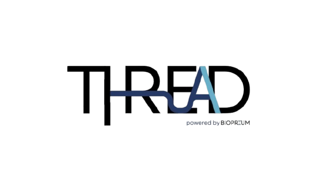

  

THREAD is a web-based software developed by Bioprium which serves as a revolutionary genetic data base and organizational foundation of Bioprium. THREAD allows authorized users to store, search, share, and retrieve genetic files. THREAD indexes and learns from each completed analysis from ARIADNE and compares new patient variants with previously studied mutations to accelerate therapeutic development
